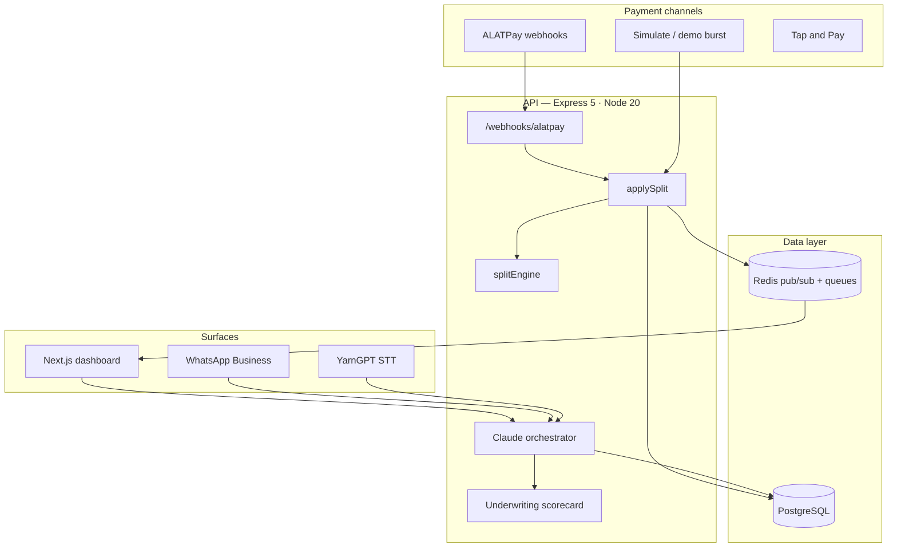

# ALATPay Streams

**Programmable income routing for Nigerian SMEs.**

Every payment that hits an ALATPay merchant account is split in real time — VAT reserve, savings, supplier float, owner salary, loan repayment — according to rules the merchant defines once and never thinks about again. An AI co-pilot handles the rest over dashboard or WhatsApp, in English or Nigerian languages.

Built for **Wema ALAT: The Evolution** — the merchant counterpart to consumer Voice, Tap & Pay, and predictive bank uptime.

---

## Why this exists

Most Nigerian SMEs run on cash flow chaos: tax money mixed with operating cash, supplier payments missed, no separation between "business money" and "my money." Banks see a lump sum. Owners see anxiety.

Streams turns **ALATPay transaction data into programmable infrastructure**:

```
Payment in → rules engine splits → buckets fill → AI acts (loan, nudge, payout)
```

| Consumer (ALAT) | Merchant (Streams) |
|-----------------|-------------------|
| SAW voice banking | **Streams Voice** — configure buckets, check sales, accept loans by speaking |
| Tap and Pay | **Tap & Pay routing** — NFC payments split like any other channel |
| Recipient bank uptime | **Streams Uptime** — rail health before loan & supplier disbursements |

---

## Architecture



**Monorepo layout**

| Path | Role | Port |
|------|------|------|
| `src/` | Backend API, split engine, AI tools, integrations | `3000` |
| `web/` | Next.js 14 dashboard + onboarding + landing | `3001` |
| `mock-alatpay/` | Local ALATPay contract simulator | `5500` |
| `prisma/` | Schema, migrations, seed |

---

## Features

### Split engine (deterministic, auditable)

Pure function — no I/O, fully unit-tested. Every naira reconciles to the kobo.

1. **FIXED** buckets first (by priority), capped at remaining amount
2. **WEEKLY_FIXED** — FIXED rules that only fire on a configured weekday
3. **PERCENTAGE** buckets on the post-FIXED remainder
4. Residual → virtual **Merchant Operating** bucket (`bucketId: null`)
5. Banker's rounding; largest split absorbs remainder so totals always match exactly

### Streams Voice

YarnGPT speech-to-text with Nigerian context — English, Pidgin, Yoruba, Igbo, Hausa. Merchants configure rules and query sales without typing.

### AI co-pilot (Claude)

Tool-calling orchestrator over dashboard chat and WhatsApp: create buckets, simulate splits, run underwriting, offer/accept loans, nudge tax deadlines.

### Underwriting

90-day transaction signals → scorecard → loan offer with documented policy (`src/services/underwriting/MODEL.md`).

### Streams Uptime

Bank rail health grid before disbursements. Loan acceptance cites recipient bank availability in natural language.

### ALATPay integration

Dual mode:

| Mode | When | Endpoint |
|------|------|----------|
| **Mock** | `ALATPAY_USE_MOCK=true` | Local contract on `:5500` |
| **Production** | `ALATPAY_USE_MOCK=false` | Official API at `apibox.alatpay.ng` |

TypeScript client mirrors the [official Python SDK](https://pypi.org/project/alatpay-sdk/) — `Ocp-Apim-Subscription-Key` auth, camelCase wire format, circuit breaker, idempotent payouts, webhook dedupe.

Production routes: payment links, virtual accounts, transaction lookup.

### WhatsApp

Meta Cloud API webhook → same orchestrator as dashboard. Voice notes transcribed via YarnGPT before processing.

---

## Quick start

### Prerequisites

- Node.js 20+
- Docker & Docker Compose

### 1. Infrastructure

```bash
docker compose up -d
```

| Service | Port | Credentials |
|---------|------|-------------|
| PostgreSQL | 5432 | `alatpay` / `alatpay` / `alatpaystreams` |
| Redis | 6379 | no auth |

### 2. Environment

```bash
cp .env.example .env
```

Minimum for local dev: `DATABASE_URL`, `REDIS_URL`, `ANTHROPIC_API_KEY`. ALATPay defaults to mock mode.

### 3. Backend

```bash
npm install
npm run db:generate
npm run db:migrate
npm run db:seed    # prints demo merchant ID — save it
npm run dev        # http://localhost:3000
```

### 4. Frontend

```bash
cd web
npm install
cp .env.example .env.local
# NEXT_PUBLIC_API_URL=http://localhost:3000
# NEXT_PUBLIC_MERCHANT_ID=<id from seed>
npm run dev                        # http://localhost:3001
```

### 5. Mock ALATPay (optional)

```bash
cd mock-alatpay
npm install && npm run dev         # http://localhost:5500
```

---

## Demo script (~2 minutes)

1. **Burst** — simulate customer payments; watch buckets animate on the dashboard
2. **Streams Voice** — mic: *"I just sold 80k today, business has been good this week"*
3. **Loan offer** — AI returns eligibility; accept
4. **Uptime** — AI cites recipient bank health; grid updates on dashboard
5. **Webhook path** — `POST /webhooks/alatpay` → split applied automatically

Full pitch notes: [`docs/PITCH.md`](docs/PITCH.md)

---

## API reference

| Method | Path | Description |
|--------|------|-------------|
| `GET` | `/health` | Full system status (DB, Redis, ALATPay mode) |
| `POST` | `/api/merchants` | Create merchant |
| `POST` | `/api/buckets` | Create bucket (Zod-validated, pct ≤ 100%) |
| `GET` | `/api/merchants/:id/buckets` | Active buckets + balances |
| `GET` | `/api/merchants/:id/transactions` | Recent transactions with splits |
| `GET` | `/api/merchants/:id/stream` | SSE live transaction feed |
| `POST` | `/api/transactions/simulate` | Apply split for `{ merchantId, amountNaira }` |
| `POST` | `/api/chat` | AI co-pilot (text) |
| `POST` | `/api/chat/voice` | AI co-pilot (voice, multipart, rate-limited) |
| `POST` | `/api/voice/transcribe` | YarnGPT transcription only |
| `GET` | `/api/uptime` | Bank availability grid |
| `GET` | `/api/merchants/:id/loans` | Loan offers & status |
| `GET` | `/api/alatpay/health` | Circuit breaker + last successful call |
| `POST` | `/api/alatpay/payment-link` | Hosted checkout (production SDK) |
| `POST` | `/api/alatpay/virtual-account` | Bank-transfer collection (production SDK) |
| `POST` | `/webhooks/alatpay` | ALATPay payment webhook → auto-split |
| `POST` | `/webhooks/whatsapp` | WhatsApp inbound |

Complete inventory: [`docs/api-inventory.md`](docs/api-inventory.md)

### Example: simulate a ₦50,000 split

```bash
curl -X POST http://localhost:3000/api/transactions/simulate \
  -H "Content-Type: application/json" \
  -d '{"merchantId":"<your-merchant-id>","amountNaira":50000}'
```

---

## Environment variables

<details>
<summary><strong>Core</strong></summary>

| Variable | Required | Description |
|----------|----------|-------------|
| `DATABASE_URL` | Yes | PostgreSQL connection string |
| `REDIS_URL` | Yes | Local `redis://` or production `rediss://` (Upstash) |
| `ANTHROPIC_API_KEY` | Yes | Claude orchestrator |
| `FRONTEND_URL` | Prod | CORS allow-list (exact Vercel URL) |
| `PORT` | No | API port (default `3000`) |

</details>

<details>
<summary><strong>ALATPay</strong></summary>

| Variable | Description |
|----------|-------------|
| `ALATPAY_USE_MOCK` | `true` = local mock · `false` = production API |
| `ALATPAY_SECRET_KEY` | Official SDK secret (`Ocp-Apim-Subscription-Key`) |
| `ALATPAY_BUSINESS_ID` | Business / merchant ID |
| `ALATPAY_WEBHOOK_SECRET_KEY` | Webhook HMAC verification |
| `ALATPAY_PUBLIC_KEY` | Checkout widget (frontend) |
| `ALATPAY_BASE_URL` | Mock: `http://localhost:5500` · Prod: `https://apibox.alatpay.ng` |

Legacy aliases `ALATPAY_API_KEY`, `ALATPAY_MERCHANT_ID`, `ALATPAY_WEBHOOK_SECRET` still work.

Runbook: [`src/integrations/alatpay/README.md`](src/integrations/alatpay/README.md)

</details>

<details>
<summary><strong>Voice & WhatsApp</strong></summary>

| Variable | Description |
|----------|-------------|
| `YARNGPT_API_KEY` | Nigerian STT ([yarngpt.ai](https://yarngpt.ai)) |
| `WHATSAPP_ACCESS_TOKEN` | Meta Cloud API |
| `WHATSAPP_PHONE_NUMBER_ID` | Business phone number ID |
| `WHATSAPP_VERIFY_TOKEN` | Webhook verification |
| `WHATSAPP_APP_SECRET` | Signature verification |

</details>

---

## Deployment

### Backend → Render

```
Build:  npm install && npx prisma generate && npm run build
Start:  npx prisma migrate deploy && npm start
```

Production checklist:

- `REDIS_URL` → Upstash `rediss://` (not localhost)
- `DATABASE_URL` → append `?sslmode=require`
- `FRONTEND_URL` → exact Vercel origin for CORS
- `ALATPAY_USE_MOCK=false` with live credentials

### Frontend → Vercel (via GitHub Actions)

Vercel Hobby blocks teammate git-author deploys. CI deploys with the account owner's token instead.

**GitHub Actions secrets** (Settings → Secrets → Actions):

| Secret | Source |
|--------|--------|
| `VERCEL_TOKEN` | [vercel.com/account/tokens](https://vercel.com/account/tokens) |
| `VERCEL_ORG_ID` | Account settings → User ID |
| `VERCEL_PROJECT_ID` | Project settings → `prj_…` |

**Vercel project env vars** (for the build):

```
NEXT_PUBLIC_API_URL=https://your-api.onrender.com
NEXT_PUBLIC_MERCHANT_ID=<demo-merchant-id>
```

`web/vercel.json` disables Vercel Git auto-deploys — only the workflow promotes production.

Workflow: [`.github/workflows/deploy-frontend.yml`](.github/workflows/deploy-frontend.yml)

---

## Testing

```bash
npm test
```

| Suite | Covers |
|-------|--------|
| `splitEngine.test.ts` | FIXED, PERCENTAGE, WEEKLY_FIXED, rounding reconciliation |
| `alatpay.integration.test.ts` | Payout idempotency, circuit breaker, webhook signatures |
| `orchestrator.integration.test.ts` | AI tools, bucket creation, underwriting, loans |
| `whatsapp.test.ts` | Message parsing, webhook verification |
| `underwriting.*.test.ts` | Scorecard signals and fixtures |

---

## Project structure

```
alatpaystreams/
├── src/
│   ├── index.ts                 Express entry + middleware
│   ├── routes/                  REST + webhooks
│   ├── services/
│   │   ├── splitEngine.ts       Pure split logic
│   │   ├── applySplit.ts        Transactional split + Redis publish
│   │   ├── underwriting/        Scorecard + pricing
│   │   └── tools/               Claude tool implementations
│   ├── integrations/
│   │   ├── alatpay/             Mock + official SDK client
│   │   ├── whatsapp/            Meta Cloud API + queue
│   │   ├── yarngpt/             Nigerian STT
│   │   └── voice/               Transcription pipeline
│   └── lib/                     DB, Redis, validation, health
├── web/                         Next.js dashboard
├── mock-alatpay/                Local payment simulator
├── prisma/                      Schema + migrations + seed
├── tests/                       Jest suites + fixtures
└── docs/                        Pitch, API inventory, security notes
```

---

## Security (demo scope)

- **No JWT yet** — demo merchant ID is public; add auth before production
- **CORS allow-list** — `localhost:3001` + `FRONTEND_URL` only
- **Webhook verification** — HMAC on ALATPay and WhatsApp payloads
- **Rate limiting** — voice endpoint: 10 req/min/merchant (Redis)
- **Input validation** — Zod on all mutating routes
- **Startup guard** — refuses production boot with localhost Redis

---

## Scripts

| Command | Description |
|---------|-------------|
| `npm run dev` | API with hot reload |
| `npm run build` | Compile TypeScript |
| `npm start` | Production API |
| `npm test` | Jest |
| `npm run db:migrate` | Prisma migrate |
| `npm run db:seed` | Demo merchant + buckets |
| `cd web && npm run dev` | Frontend dev server |

---

## License

ISC

---

<p align="center">
  <strong>ALATPay Streams</strong> — income that knows where it belongs.<br/>
  Wema Hackathon · ALAT: The Evolution
</p>
